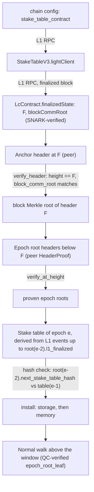

# Stake table catchup: trust chain

How a node that is more than one epoch behind installs stake tables from the LC contract instead of walking every epoch,
and what each fetched value is checked against. Mechanism details: `doc/agents/architecture.md` (Validator startup).

## Summary

- One trust root: the LC contract's SNARK-verified `finalizedState`, read over L1 RPC.
- Peers supply data only. Every peer answer is checked against that root before use.
- Trusted inputs: chain config and L1 RPC.

## Trust chain

| Link                            | Source                                                                                     | Check                                                                                                                                                              | Code                                                                                                                                                                                   |
| ------------------------------- | ------------------------------------------------------------------------------------------ | ------------------------------------------------------------------------------------------------------------------------------------------------------------------ | -------------------------------------------------------------------------------------------------------------------------------------------------------------------------------------- |
| 0. LC contract address          | L1: `StakeTableV3(chain_config.stake_table_contract).lightClient()`                        | Trusted: chain config plus L1 RPC                                                                                                                                  | `crates/espresso/types/src/v0/impls/stake_table.rs` `lc_contract_finalized_state`                                                                                                      |
| 1. `F`, `blockCommRoot`         | L1: `LightClientV3.finalizedState()` at the L1 finalized block                             | SNARK-verified by the contract; L1 RPC trusted                                                                                                                     | same                                                                                                                                                                                   |
| 2. Anchor header at `F`         | Peer: `/v1/catchup/{F}/leafchain` (first leaf), or request-response                        | `verify_header`: height is `F`, `light_client_state.block_comm_root` equals the contract's. Leaf chain QCs are not checked; only the header's Merkle root is used. | `crates/espresso/types/src/v0/impls/lc_contract.rs` `verify_header`; callers in `crates/espresso/node/src/catchup.rs` and `crates/espresso/node/src/request_response/catchup/state.rs` |
| 3. Epoch root headers below `F` | Peer: `HeaderProof` (`/v1/light-client/header/{F}/{h}`)                                    | `verify_at_height(anchor_root, h)`: Merkle proof against the block Merkle root of header `F`                                                                       | `crates/light-client/src/consensus/header.rs` `verify_at_height`                                                                                                                       |
| 4. Stake table of epoch `e`     | Derived locally from L1 stake table events up to `root(e-2).l1_finalized` (`StoredThenL1`) | Deterministic from L1. `root(e-2).next_stake_table_hash` is compared with the held table of `e-1`; a mismatch ends the process.                                    | `crates/espresso/types/src/v0/impls/committee.rs` `install_root`                                                                                                                       |
| 5. Block reward                 | Timestamps of the proven roots plus the preceding root                                     | Covered by link 3                                                                                                                                                  | `crates/espresso/types/src/v0/impls/committee.rs` `derive_stake_table`                                                                                                                 |
| 6. Epochs above the window      | Normal walk: `epoch_root_leaf`, QC-verified against held table `e-2`                       | Unchanged by the seed                                                                                                                                              | `crates/hotshot/types/src/epoch_membership.rs` `epoch_root_leaf`                                                                                                                       |

## Fetch order in one `catchup(target)`

`EpochMembershipCoordinator::catchup` in `crates/hotshot/types/src/epoch_membership.rs`.

1. `held_pair_top` finds the highest held consecutive pair `(start-1, start)` in memory or storage.
2. If `start + 1 < target`, the seed takes `seed_lock` and re-checks `start`.
3. L1 reads: LC address (cached in a `OnceCell`), then `finalizedState` at the L1 finalized block.
4. `seed_window` (`crates/espresso/types/src/v0/impls/lc_contract.rs`) picks the epochs to install:
   - `last = min(target, epoch(F) + 1)`
   - `first = max(last - 4, start + 1, 3)`
   - At most 5 tables, covering the target's DRB and rewards.
   - `preceding_root = root(first - 3)` when `first > first_epoch + 4`.
   - Returns `None` (no seed) when the walk from `start` reaches the target or `epoch(F)` without one.
5. Anchor: one request for the header at `F`, then `verify_header`.
6. Proven headers: the preceding root first, then `root(e-2)` for each `e` in the window, ascending. Up to 3 requests in
   flight (`crates/espresso/node/src/lc_contract_seed.rs`), each up to 5 attempts.
7. `EpochCommittees::install_epoch_roots`, ascending, each root under `catchup_timeout`. Per root, `install_root`:
   1. `store_epoch_root`
   2. `update_chain_config`
   3. fixed block reward (V3 only)
   4. derive the table from L1 events
   5. hash check of the previous epoch
   6. write storage, then memory
8. `backfill.request_fill()` runs whether or not the install succeeded.
9. The walk runs from `last + 1` to `target`.
10. `drb_ready(target)`.

On a seed failure at any step: `warn!` "catchup seed failed, walking", then the walk runs from the original `start`.

## Backfill below the window (async)

`StakeTableBackfill` in `crates/espresso/node/src/stake_table_backfill.rs`.

- Read order:
  1. Stored epochs (no L1 read when nothing is missing).
  2. LC state.
  3. One anchor.
  4. Initial token supply.
  5. Proven roots of the missing epochs below `F`, one request at a time, newest first.
- Tables are derived from stored events only (`StoredOnly`, no L1 event fetch).
- Each table is checked against `next_root.next_stake_table_hash` (`EpochCommittees::store_derived_stake_table`).
  - A mismatch is not stored and is logged once with `error!`. The process continues, unlike the install path.
- Backfilled tables go to storage only, never to memory.

## Follower differences

- Same `LcContractSeed`.
- Provider: `--state-peers`, or the upstreams when unset. No request-response.
- Requests one table from the coordinator: the next ingest epoch, or the one after once past the epoch root. Runs at
  init and at each poll.
- A failed request is logged; the next poll retries. Startup is bounded by `--bootstrap-epoch-catchup-timeout`.

## Hash-check coverage gaps

- **Top of the window:** installing `root(e-2)` checks the table of `e-1`. `table(last)` stays unchecked until the walk
  or live consensus adds `root(last-1)`.
- **Bottom of the window:** `table(first-1)` is checked only if held. With a gap below the window, the backfill checks
  it later.
- **Scope of the check:** guards against a faulty L1 provider. Table correctness rests on L1 RPC plus the proven root's
  `l1_finalized`.

## Design notes

- The leaf chain at `F` supplies only the header at `F`. Its QCs are not verified; the `block_comm_root` match against
  the SNARK-verified contract state is the stronger check.
- Only headers below `F` are provable: the block Merkle tree in header `F` commits to blocks `0..F-1`. Hence `last` is
  capped at `epoch(F) + 1`; that table comes from `root(epoch(F) - 1)`, which is below `F`.
- `next_stake_table_hash` lags one root: a root decides the hash of the epoch before the one it defines. Installing
  `root(e-2)` therefore checks table `e-1`, and the top of the window waits one more root for its check.

## Not implemented: stake tables from peers

A faster variant takes the stake table from a peer and checks it against a proven root instead of deriving it from L1
stake table events. Not needed today: the event-derived install is fast enough.

### Outline

1. Same anchor as today: LC contract `finalizedState`, header at `F`, proven epoch roots below `F`.
2. For each table `e` in the window, request the full `StakeTableState` of epoch `e` from a peer (new request-response
   request and HTTP endpoint).
3. Accept it iff `state.commit()` equals the proven `root(e-1).next_stake_table_hash`. The hash commits to the full
   state: all registered validators, exits and used keys (`ValidatorSet::from_state`). A mismatch rejects that peer's
   answer and asks the next peer; no process exit, since the peer is untrusted.
4. Derive the active set locally with `select_active_validator_set` at the root's protocol version. Block reward as
   today.
5. Install as today: storage, then memory.

### Effects

- No L1 event replay on the startup path. Trust drops to the LC contract plus Merkle proofs; L1 RPC is no longer trusted
  for the window's tables.
- Every installed table is hash-checked at install. The top and bottom gaps above disappear.
- `table(e)` needs proven `root(e-1)`. `root(epoch(F))` lies 5 blocks before the end of `epoch(F)` and is usually above
  `F`, so `table(epoch(F) + 1)` is usually not provable. The window top drops to `epoch(F)`, or that one table falls
  back to event derivation.

### Required changes

- Peers serve `StakeTableState` per epoch. Per-epoch storage holds the active map, the hash and all validators
  (`MembershipPersistence::store_stake`, `store_all_validators`), not the exit and used-key sets. Peers either rebuild
  the state from stored events or storage gains the full state.
- Later epochs still derive tables by replaying all events from L1 block 0 (`validator_set_from_stored_events`). Without
  incremental derivation (verified state of `e` plus events after `root(e-2).l1_finalized`), the full event history is
  still fetched before the next epoch root; the variant only moves that cost off the startup path.
