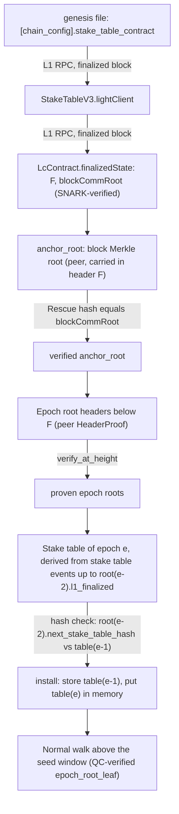

# Stake table catchup: trust chain

How a node that is more than one epoch behind installs stake tables from the LC contract instead of walking every epoch,
and what each fetched value is checked against. Mechanism details: `doc/agents/architecture.md` (Validator startup).

## Notation

- `F`: `finalizedState.blockHeight` of the LC contract, the highest block height with a proof accepted by the LC
  contract.
- `blockCommRoot`: `finalizedState.blockCommRoot`, a field element (BN254 scalar) that is the Rescue hash of the block
  Merkle root at height `F`, the tree over blocks `0..F-1`. The contract stores the hash, not the root, because the
  circuit works over the BN254 field. A Merkle proof needs the root itself, which the hash does not reveal.
- `epoch(h)`: the epoch that contains block height `h`.
- `table(e)`: the stake table of epoch `e`.
- `root(e)`: the epoch root header of epoch `e`, 5 blocks before the end of `e`. Its `next_stake_table_hash` is the hash
  of `table(e+1)`. Its L1 block fixes the stake table events that define `table(e+2)`.
- held: in the node's memory or storage.
- walk: the default catchup, one epoch at a time. Each epoch root leaf is fetched from a peer and its QC is checked
  against the held table two epochs below.
- seed: the step before the walk that installs a seed window of tables from proven epoch roots, anchored at the LC
  contract (`LcContractSeed`).
- seed window: the epochs `seed_window_first..=seed_window_last` whose tables one seed installs, at most 5.
- `anchor_root`: the block Merkle root at height `F`. A peer supplies it, because the contract holds only its hash.
  `verify_block_merkle_root` hashes it and compares the result with `blockCommRoot`. It arrives inside the header at
  `F`, and no other field of that header is used or trusted. Every epoch root the seed uses is proven against it.
- `top_held_epoch` (`start` in code): the top of the highest pair of consecutive held epochs.
- `requested_epoch` (`epoch` or `target` in code): the epoch catchup was asked for.
- `seed_window_first`, `seed_window_last` (`first`, `last` in code): the lowest and highest epoch of the seed window.
- preceding root: `root(seed_window_first-3)`, fetched only for the block reward of `table(seed_window_first)`.

## Where `requested_epoch` comes from

- Validator: from a peer. A node that starts behind knows only its stored anchor epoch. Its timeout vote reaches
  up-to-date peers, which reply with their locked QC. That QC's `epoch` is `requested_epoch`.
- The claim is checked after catchup: the QC commits to its epoch and block number, and its signatures must reach the
  threshold of the table catchup installed for that epoch. Only then does the node's own epoch advance.
- Catchup does not take the peer's tables on trust: the seed stops at `epoch(F) + 1` from the LC contract, and the walk
  above it accepts only QC-checked epoch roots.
- Follower: the next ingest epoch, from a block height the upstream reports and the light client checks with a finality
  proof.
- Query API: the epoch named in a state certificate request, accepted only up to the node's own decided epoch.

## Summary

- One trust root: the LC contract's SNARK-verified `finalizedState`, read over L1 RPC.
- Peers supply data only. The seed's peer answers (`anchor_root`, header proofs) are checked against that root before
  use. Chain configs fetched from peers are checked against the commitment in a proven header. Leaves of the walk above
  the seed window and of `drb_ready` are QC-checked against the installed tables.
- Trusted inputs:
  - genesis file: `[chain_config].stake_table_contract`
  - L1 RPC
  - local storage: stake table events, and stored committees, whose validators, reward and hash are reused without
    recomputing
  - the LC contract owner, who can upgrade the contract (`LightClient._authorizeUpgrade`)
  - the stake table contract admin (`DEFAULT_ADMIN_ROLE`), who can upgrade it and so change the `lightClient()` address
    it returns
  - the LC contract circuit, whose proof `newFinalizedState` verifies
- Not trusted: the permissioned prover, when one is set (`LightClient.permissionedProver`). It only limits who may
  submit a proof, so it affects how recent `F` is, not its correctness.

## Trust chain

| #   | Value                        | From                                                               | Checked by                                         |
| --- | ---------------------------- | ------------------------------------------------------------------ | -------------------------------------------------- |
| 0   | LC contract address          | L1, finalized block                                                | trusted                                            |
| 1   | `F`, `blockCommRoot`         | L1, finalized block                                                | SNARK, in the contract                             |
| 2   | `anchor_root`                | peer                                                               | Rescue hash equals `blockCommRoot`                 |
| 3   | Root headers below `F`       | peer                                                               | Merkle proof against `anchor_root`                 |
| 4   | Table of epoch `e`           | stored and L1 events                                               | hash at the next root, when both hashes exist      |
| 5   | Block reward                 | root headers (link 3), stake of table `e` (link 4), initial supply | no separate check; computed or reused from storage |
| 6   | Epochs above the seed window | peer leaves                                                        | QC against table `e-2`                             |

### Link details

0. LC contract address
   - `StakeTableV3(chain_config.stake_table_contract).lightClient()`.
   - Trusts the genesis file, L1 RPC and the stake table contract admin.
1. `F`, `blockCommRoot`
   - `LightClientV3.finalizedState()` at the L1 finalized block.
   - Trusts L1 RPC, the LC contract owner and the circuit.
2. `anchor_root`
   - Why a peer supplies it: `blockCommRoot` is a hash of the root, and Merkle proofs verify against the root.
   - Carried in the header at `F`: first leaf of `/v1/catchup/{F}/leafchain`, or request-response.
   - `verify_block_merkle_root` checks that its Rescue hash equals `blockCommRoot`.
   - The header's other fields and the leaf chain QCs are not checked or used.
3. Root headers below `F`
   - `HeaderProof` from `/v1/light-client/header/{F}/{h}`, or `Request::HeaderProof` over request-response.
   - `verify_at_height(anchor_root, h)`: Merkle proof against `anchor_root`.
4. Table of epoch `e`
   - Derived from stake table events up to `root(e-2).l1_finalized`: stored events, plus L1 for what storage lacks
     (`StoredThenL1`).
   - `install_root` compares `root(e-2).next_stake_table_hash` with the held table of `e-1`. A mismatch ends the
     process.
   - Skipped silently when the root has no `next_stake_table_hash` (older versions) or `e-1` is not held. Skipped with a
     `warn!` when the held `e-1` has no hash.
5. Block reward
   - Inputs: proven root fields (timestamp, `total_reward_distributed`) of the roots and the preceding root, stake of
     the derived table, initial token supply (constant or L1).
   - At protocol version 0.3 the fixed reward is used. A held reward is reused.
6. Epochs above the seed window
   - Normal walk: `epoch_root_leaf`, QC-checked against held table `e-2`.
   - Unchanged by the seed.

## Fetch order in one `catchup(requested_epoch)`

In `EpochMembershipCoordinator::catchup`.

1. Startup loads the 20 newest stored tables into memory. `held_pair_top` finds the highest held consecutive pair
   `(top_held_epoch-1, top_held_epoch)`, searching down from the lower of `requested_epoch - 1` and the highest
   in-memory epoch.
2. If `top_held_epoch + 1 < requested_epoch`, the seed takes `seed_lock` and re-checks `top_held_epoch`.
3. L1 reads: the finalized block number, the LC contract address (cached in a `OnceCell`), then `finalizedState`, both
   at that finalized block.
4. `seed_window` picks the epochs to install:
   - `seed_window_last = min(requested_epoch, epoch(F) + 1)`
   - `seed_window_first = max(seed_window_last - 4, top_held_epoch + 1, 3)`
   - At most 5 tables, covering the requested epoch's DRB and rewards.
   - `preceding_root = root(seed_window_first - 3)` when `seed_window_first > first_epoch + 4`.
   - Returns `None` (no seed) when the walk from `top_held_epoch` reaches `requested_epoch` or `epoch(F)` without one.
5. `anchor_root`, from the header at `F`, checked by `verify_block_merkle_root`.
6. Proven headers: the preceding root first, then `root(e-2)` for each `e` in the seed window, ascending. Up to 3
   requests in flight.
   - `anchor_root` and each proven header get up to 5 attempts, or 1 with `ESPRESSO_NODE_CATCHUP_BACKOFF_DISABLE`.
   - One HTTP attempt asks the state peers in turn.
7. `EpochCommittees::install_epoch_roots`, ascending, each root under `catchup_timeout`. Per root `e`, `install_root`:
   1. `store_epoch_root`. A failure is logged and the install continues, so a seed can succeed with the root header
      missing from storage.
   2. `update_chain_config`
   3. fixed block reward (protocol version 0.3 only)
   4. Returns if the held committee of `e` already has a block reward, header and hash.
   5. Derives table `e` from events. A held table with a hash is reused, not re-derived.
   6. Runs the hash check of `e-1`.
   7. Stores the held table of `e-1`, then puts table `e` in memory. Table `e` is not stored here, so the seed does not
      persist `table(seed_window_last)`. Seed and backfill installs need a reward; a missing reward is an error before
      the memory update.
8. `backfill.request_fill()` runs after the install step, whether or not it succeeded. A failure before the install step
   does not call it.
9. The walk runs from `seed_window_last + 1` to `requested_epoch`.
10. `drb_ready(requested_epoch)`.

On a seed failure at any step: `warn!` "catchup seed failed, walking". The walk then runs from `top_held_epoch` as
re-read under `seed_lock`. Tables installed before the failure are kept and skipped.

## Backfill below the seed window (async)

In `StakeTableBackfill`.

- Read order:
  1. Stored epochs (no L1 read when nothing is missing).
  2. LC contract state.
  3. One `anchor_root`.
  4. Initial token supply.
  5. Proven roots of the missing epochs below `F`: root, next root and preceding root per epoch. Chunks of 20 epochs,
     newest chunk first. Inside a chunk, one request at a time, heights ascending.
- Tables are derived from stored events only (`StoredOnly`, no L1 event fetch) and stored newest first.
- Each table is checked against `next_root.next_stake_table_hash` (`EpochCommittees::store_derived_stake_table`).
  - A mismatch is not stored and is logged once with `error!`. The process continues, unlike the install path.
  - When either hash is missing, the table is stored without the comparison.
- Backfilled tables go to storage only, never to memory.

## Follower differences

- Same `LcContractSeed`, installed only when the follower has upstreams. Without upstreams the follower walks.
- Provider: `--state-peers`, or the upstreams when unset. No request-response.
- Requests one table from the coordinator: the next ingest epoch, or the one after once past the epoch root. Runs at
  init and at each poll.
- `--bootstrap-epoch-catchup-timeout` bounds the stake table wait at startup and in each poll, not the block fetches. A
  poll already at the tip requests no table. A failed request is logged and the next poll retries. A failure is not an
  error when the table is already held.

## Hash-check coverage gaps

- **Top of the seed window:** installing `root(e-2)` checks the table of `e-1`. `table(seed_window_last)` stays
  unchecked until the walk or live consensus adds `root(seed_window_last-1)`.
- **Bottom of the seed window:** the seed does not install `table(seed_window_first-1)`. Its check reads memory and is
  skipped when the table is absent.
  - With no gap below the seed window, `seed_window_first = top_held_epoch + 1`. `held_pair_top` has already loaded
    `top_held_epoch` into memory (`load_stake_table` inserts what it reads), so the check runs.
  - With a gap, `table(seed_window_first-1)` is not held. The backfill later derives its own copy from stored events and
    checks that.
  - With `seed_window_first == seed_window_last`, no seeded table is hash-checked at install.
- **Scope of the check:** guards against a faulty L1 provider. Table correctness rests on L1 RPC plus the proven root's
  `l1_finalized`.

## Design notes

- The leaf chain at `F` only carries `anchor_root`, in its first header. Its QCs and the header's other fields are
  unverified and unused.
- Only headers below `F` are provable: the block Merkle tree in header `F` commits to blocks `0..F-1`. Hence
  `seed_window_last` is capped at `epoch(F) + 1`; that table comes from `root(epoch(F) - 1)`, which is below `F`.
- `next_stake_table_hash` lags one root: a root decides the hash of the epoch before the one it defines. Installing
  `root(e-2)` therefore checks table `e-1`, and the top of the seed window waits one more root for its check.

## Not implemented: stake tables from peers

A faster variant takes the stake table from a peer and checks it against a proven root instead of deriving it from L1
stake table events. Not needed today: the event-derived install is fast enough.

### Outline

1. Same anchor as today: LC contract `finalizedState`, `anchor_root`, proven epoch roots below `F`.
2. For each table `e` in the seed window, request the full `StakeTableState` of epoch `e` from a peer (new
   request-response request and HTTP endpoint).
3. Accept it iff `state.commit()` equals the proven `root(e-1).next_stake_table_hash`. The hash commits to the full
   state: all registered validators, exits and used keys (`ValidatorSet::from_state`). A mismatch rejects that peer's
   answer and asks the next peer; no process exit, since the peer is untrusted. Only for tables selected at protocol
   version 0.7 or later (`CANONICAL_STAKE_TABLE_ORDER_VERSION`). Before it, registration order can change the selected
   committee and `state.commit()` does not cover that order, so those tables stay derived from events.
4. Derive the active set locally with `select_active_validator_set` at the protocol version of `root(e-2)`, as today.
   `root(e-1)` only supplies the hash. Across an upgrade the two roots can carry different selection rules. Block reward
   as today.
5. Install as today.

### Effects

- The seed no longer replays stake table events. The cold L1 event scan stays on startup: startup awaits
  `prefetch_stake_table_events`, a full scan on an empty database, before the coordinator exists. Moving that scan off
  startup also requires changing the prefetch.
- L1 RPC stays trusted for the LC contract reads, which anchor every proof.
- Every peer-supplied table is hash-checked at install.
- `table(e)` needs proven `root(e-1)`. The LC contract rejects an `F` past the epoch root of its epoch, so
  `root(epoch(F)) >= F` and `table(epoch(F) + 1)` is never provable. The seed window top drops to `epoch(F)`, or that
  one table is derived from events and stays unchecked at install, as today.

### Required changes

- Peers serve `StakeTableState` per epoch. Per-epoch storage holds the active map, the hash and all validators
  (`MembershipPersistence::store_stake`, `store_all_validators`), not the exit and used-key sets. Peers either rebuild
  the state from stored events or storage gains the full state.
- Later epochs still derive tables by replaying all events from L1 block 0 (`validator_set_from_stored_events`). Without
  incremental derivation (verified state of `e` plus events after `root(e-2).l1_finalized`), the full event history is
  still needed before the next epoch root, so the startup prefetch cannot simply be dropped.
